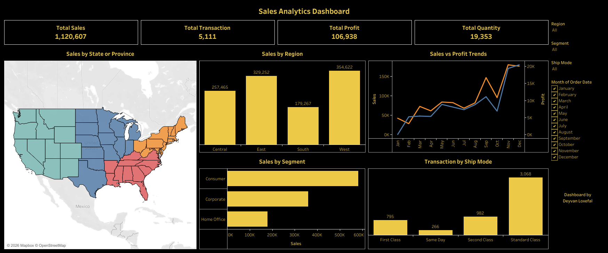

# 📊 Sales Analytics Dashboard



**TL;DR:** Interactive Tableau dashboard on 5,111 retail orders ($1.12M sales, $106.9K profit, 9.5% margin). The dashboard covers sales by region, segment, ship mode and month. A follow-up analysis of the same dataset shows where profit leaks: **Furniture** (2.8% margin, driven by Tables and Bookcases) and the **Central** region (3.9% margin).

🔗 **[Open the live dashboard on Tableau Public](https://public.tableau.com/views/SalesAnalyticsDashboard_17931092775800/Dashboard1?:language=en-US&publish=yes&:sid=&:redirect=auth&:display_count=n&:origin=viz_share_link)**

| | |
|---|---|
| **Tool** | Tableau (dashboard), Excel (source data) |
| **Type** | Individual project |
| **Author** | Deyvan Loxefal |

---

## 1. Business Context
A retail/wholesale business wants to know how it is performing and where it loses money. The questions behind this project:
1. What are the headline KPIs (sales, profit, orders, units)?
2. How do sales vary by month, region, customer segment and shipping mode?
3. Which product categories and regions are profitable, and which erode margin?

## 2. Data & Process
* **Dataset:** Superstore-style sample retail dataset, file `data/Sales Dataset.xlsx` (sheet `Sheet1`). *Source link: add here.*
* **Size:** 5,111 rows, 21 columns, one row per order (5,111 unique Order IDs), 19,353 units sold.
* **Period:** Order dates run from 2023-01-03 to 2026-12-30. The dates appear to be shifted for the sample dataset (the latest orders are dated after the date this project was written), so treat the data as illustrative, not as live business data.
* **Columns:** order and customer info, geography (state, region), product (category, sub-category), and three measures: Sales, Quantity, Profit.
* **Validation:** 0 duplicate rows, 0 missing values, Order IDs unique. Data was otherwise already clean, so the work focused on data type checks and building the Tableau model and visuals.

## 3. What the Dashboard Shows
| Visual | Purpose |
|---|---|
| KPI cards | Total Sales (1,120,607), Total Transactions (5,111), Total Profit (106,938), Total Quantity (19,353) |
| Sales by State or Province (map) | Geographic spread of the four regions |
| Sales by Region | West 354,622 · East 329,252 · Central 257,465 · South 179,267 |
| Sales vs Profit Trends | Monthly sales and profit (all years combined) |
| Sales by Segment | Consumer 582,164 · Corporate 359,821 · Home Office 178,623 |
| Transaction by Ship Mode | Standard Class 3,068 (60%) · Second 982 · First 795 · Same Day 266 |
| Filters | Region, Segment, Ship Mode, Month |

## 4. Key Findings

### From the dashboard
* **West is the largest region** with $354,622 (31.6% of sales), followed by East (29.4%).
* **Strong Q4 seasonality:** Q4 accounts for 40.4% of annual sales, and November + December alone for 32%. September is also a spike (about $147K, the third-highest month), which suggests demand starts building in late Q3.
* **Consumer is the biggest segment** (52% of sales). **Standard Class** handles 60% of orders.

### From a deeper analysis of the dataset (not shown in the dashboard)
Profit by state, category and sub-category was analyzed directly from the dataset, since the dashboard focuses on sales.

* **Furniture has the highest sales but the lowest margin.**

  | Category | Sales | Profit | Margin |
  |---|---:|---:|---:|
  | Furniture | $638,815 | $18,033 | **2.8%** |
  | Office Supplies | $300,663 | $53,149 | 17.7% |
  | Technology | $181,130 | $35,755 | 19.7% |

  Within Furniture, **Tables** (−8.2% margin, −$12,387) and **Bookcases** (−3.4%, −$3,756) lose money. Without these two sub-categories, Furniture margin would be roughly 9%.
* **Central is the weakest region by margin:** 3.9%, versus West 11.6%, East 11.5% and South 9.9%.
* **Most unprofitable states:** Texas (−$13,186), Illinois (−$12,335), Pennsylvania (−$8,543) and Ohio (−$4,709). Texas and Illinois belong to the Central region.
* **Highest-margin sub-categories:** Paper (42.8%) and Copiers (35.2%), among the larger-volume ones.
* **Margin is not steady year to year:** 8.8% (2023), 6.8% (2024), 11.1% (2025), 10.4% (2026), while sales grew 58% from 2023 to 2026.

## 5. Recommendations
These are directions to investigate, based on the patterns above, not proven causes.

1. **Review Tables and Bookcases pricing and cost.** They drive most of the Furniture loss. The dataset has no discount or cost columns, so the root cause (discounting, shipping, supplier cost) still needs to be confirmed.
2. **Audit the Central region and loss-making states** (Texas, Illinois, Pennsylvania, Ohio) for logistics cost and discount policy.
3. **Prepare for Q4 from late Q3.** Plan inventory and marketing from September, ahead of the November–December peak.
4. **Test pairing Furniture with high-margin products** (Paper, Copiers) as a pilot. The data cannot validate this idea because each order contains one product line, so it needs a test or basket-level data.

## 6. Limitations
* No Discount, Cost or Shipping Cost columns, so causes of low margin cannot be proven.
* One product line per order, so basket and cross-sell analysis is not possible.
* Sample dataset with shifted dates; findings illustrate the analysis approach rather than a real business.
* The trend chart combines all years into Jan–Dec, which mixes seasonality with growth. Year-level figures in Section 4 were computed separately.
* Descriptive analysis only: no forecasting or statistical testing.

## 7. Repository Structure
```
├── README.md
├── assets/
│   ├── Sales Analytics Dashboard.twb    # Tableau workbook
│   └── salesanalyticsdashboard.png      # Dashboard preview
└── data/
    └── Sales Dataset.xlsx               # Sheet1 = data, Sheet2 = pivot scratch sheet
```
To open the workbook, use Tableau Desktop. If it asks for the data source, point it to `data/Sales Dataset.xlsx`.
